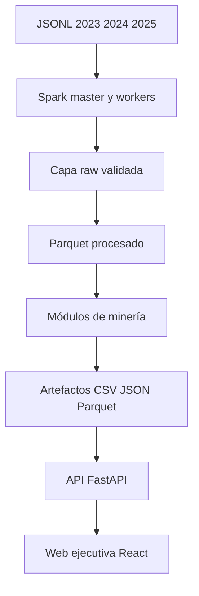

# Plan de ejecución del proyecto de minería de contrataciones públicas

## 1. Definición del proyecto

### 1.1 Tema

Análisis de los procesos de contratación pública del Perú publicados por el OECE en el estándar OCDS durante los años 2023, 2024 y 2025.

### 1.2 Fuente de datos

- Fuente: Registro de Datos OCDS del Organismo Especializado para las Contrataciones Públicas Eficientes.
- Portal: <https://data.open-contracting.org/es/publication/135>
- Formato de entrada: JSON Lines comprimido con GZIP, `jsonl.gz`.
- Archivos seleccionados: 2023, 2024 y 2025.
- Identificador principal: `ocid`.
- Licencia declarada por la fuente: CC BY 4.0.

### 1.3 Objetivo general

Aplicar técnicas de procesamiento distribuido, similitud aproximada, búsqueda aproximada de vecinos, minería de flujos y reglas de asociación sobre datos reales de contrataciones públicas, comunicando todos los resultados mediante una aplicación web interactiva ejecutada con Docker.

### 1.4 Preguntas de investigación

**Pregunta 1.** ¿Cómo se distribuye y concentra el valor de las contrataciones públicas entre entidades, proveedores, categorías y departamentos durante 2023, 2024 y 2025?

**Pregunta 2.** ¿Qué procesos presentan descripciones altamente similares y qué precisión se obtiene al utilizar MinHash y LSH frente a la similitud de Jaccard exacta?

**Pregunta 3.** ¿Qué mejora de tiempo se obtiene al utilizar HNSW o IVF frente a la búsqueda exacta de contrataciones similares y cuánto recall se pierde?

**Pregunta 4.** ¿Con qué precisión Bloom Filter, Count-Min Sketch y DGIM resumen la aparición y frecuencia de eventos dentro del flujo temporal de contrataciones?

**Pregunta 5.** ¿Qué combinaciones de categoría, modalidad, departamento, rango de monto y nivel de competencia aparecen juntas con mayor frecuencia?

### 1.5 Principio de implementación

Se seguirá la arquitectura **calcular una vez y explorar muchas veces**:

1. Spark procesa los JSON y ejecuta los cálculos pesados fuera de línea.
2. Los resultados se guardan como Parquet, CSV y JSON pequeños.
3. La aplicación web consume esos resultados y responde inmediatamente a los filtros.
4. Solo los cálculos ligeros, como fórmulas de error o filtrado de reglas, se recalculan en vivo.

La web no debe ejecutar nuevamente todo Spark cada vez que el usuario mueva un control.

---

## 2. Arquitectura general en Docker

El proyecto se ejecutará completamente mediante contenedores.



### 2.1 Servicios de Docker Compose

| Servicio | Responsabilidad |
|---|---|
| `spark-master` | Coordinar la ejecución distribuida |
| `spark-worker-1` | Ejecutar particiones y tareas de Spark |
| `spark-worker-2` | Ejecutar particiones y tareas de Spark |
| `pipeline` | Ejecutar descarga, KDD, EDA y algoritmos |
| `api` | Filtrar y exponer los artefactos mediante una API REST |
| `web` | Servir la aplicación ejecutiva React y enrutar `/api` |

### 2.2 Volúmenes compartidos

| Volumen | Contenido |
|---|---|
| `data_raw` | JSONL GZIP originales de 2023 a 2025 |
| `data_processed` | Tablas analíticas en Parquet |
| `artifacts` | Resultados destinados a la web |

### 2.3 Puertos propuestos

| Servicio | Puerto |
|---|---:|
| Spark Master | 7077 |
| Spark UI | 8080 |
| Spark Worker 1 UI | 8081 |
| Spark Worker 2 UI | 8082 |
| API FastAPI | 8000 |
| Web React | 8501 |

### 2.4 Comandos principales

```bash
# Construir las imágenes
docker compose build

# Iniciar Spark y la web
docker compose up -d spark-master spark-worker-1 spark-worker-2 api web

# Descargar y validar los JSON
docker compose run --rm pipeline python -m src.ingestion.download

# Ejecutar todo el procesamiento
docker compose run --rm pipeline python -m src.run_all

# Ver los contenedores
docker compose ps

# Ver los logs de la web
docker compose logs -f web

# Abrir la aplicación
http://localhost:8501

# Detener el proyecto
docker compose down
```

El comando `docker compose down` no debe eliminar los volúmenes. La eliminación de datos solo se realizará conscientemente mediante `docker compose down -v`.

---

## 3. Estructura propuesta del repositorio

```text
oece-mineria-datos/
├── api/
│   ├── main.py
│   └── store.py
├── frontend/
│   ├── src/
│   │   ├── pages/
│   │   ├── App.jsx
│   │   └── components.jsx
│   ├── package.json
│   └── nginx.conf
├── src/
│   ├── config.py
│   ├── run_all.py
│   ├── ingestion/
│   │   ├── download.py
│   │   ├── validate_files.py
│   │   └── inspect_schema.py
│   ├── processing/
│   │   ├── build_processes.py
│   │   ├── build_items.py
│   │   ├── build_awards.py
│   │   ├── build_suppliers.py
│   │   ├── normalize_text.py
│   │   └── quality_report.py
│   ├── part1/
│   │   ├── eda_spark.py
│   │   ├── aggregations_dataframe.py
│   │   ├── aggregations_rdd.py
│   │   └── benchmark.py
│   ├── part2/
│   │   ├── exact_jaccard.py
│   │   ├── minhash_lsh.py
│   │   └── evaluate_lsh.py
│   ├── part3/
│   │   ├── vectorize.py
│   │   ├── exact_search.py
│   │   ├── hnsw.py
│   │   └── evaluate_ann.py
│   ├── part4/
│   │   ├── bloom_filter.py
│   │   ├── count_min_sketch.py
│   │   ├── dgim.py
│   │   └── evaluate_streams.py
│   ├── part5/
│   │   ├── transactions.py
│   │   ├── apriori.py
│   │   ├── fp_growth.py
│   │   └── evaluate_rules.py
│   └── export/
│       └── web_artifacts.py
├── data/
│   ├── raw/
│   └── processed/
├── artifacts/
│   ├── metadata/
│   ├── eda/
│   ├── similarity/
│   ├── ann/
│   ├── streaming/
│   └── association/
├── tests/
├── Dockerfile.pipeline
├── Dockerfile.api
├── Dockerfile.frontend
├── docker-compose.yml
├── requirements-pipeline.txt
├── requirements-api.txt
├── Makefile
└── README.md
```

---

## 4. Fase 0: preparación del entorno Docker

### 4.1 Objetivo

Conseguir que todo el proyecto pueda levantarse y ejecutarse sin depender de configuraciones manuales del equipo anfitrión.

### 4.2 Actividades

1. Crear `Dockerfile.pipeline` con Python, Java y PySpark.
2. Crear `Dockerfile.api` con FastAPI y pandas, y `Dockerfile.frontend` con React y Nginx.
3. Configurar Spark Master y dos workers en `docker-compose.yml`.
4. Configurar los volúmenes compartidos.
5. Definir variables en `.env.example`.
6. Incorporar health checks.
7. Probar el acceso desde `pipeline` al Spark Master.
8. Probar que la API puede leer `artifacts` y que React consume sus endpoints.

### 4.3 Variables mínimas

```env
SPARK_MASTER_URL=spark://spark-master:7077
RAW_PATH=/data/raw
PROCESSED_PATH=/data/processed
ARTIFACTS_PATH=/artifacts
ANALYSIS_YEARS=2023,2024,2025
WEB_PORT=8501
RANDOM_SEED=42
```

### 4.4 Criterio de finalización

- `docker compose build` termina sin errores.
- Spark Master reconoce dos workers.
- La web responde en `http://localhost:8501`.
- Todos los contenedores acceden a los volúmenes previstos.

---

## 5. Fase 1: descarga, validación e ingesta de los JSON

### 5.1 Objetivo

Descargar y conservar los JSONL GZIP originales de 2023, 2024 y 2025, verificando integridad, esquema y cobertura temporal.

### 5.2 Archivos esperados

```text
data/raw/oece_2023.jsonl.gz
data/raw/oece_2024.jsonl.gz
data/raw/oece_2025.jsonl.gz
```

### 5.3 Actividades

1. Descargar los tres archivos desde la fuente oficial.
2. Registrar URL, fecha, tamaño y hash SHA-256.
3. Verificar que cada línea pueda interpretarse como JSON.
4. Revisar el esquema inferido por Spark.
5. Contar registros por archivo.
6. Detectar archivos corruptos o vacíos.
7. Extraer las fechas efectivas de los procesos.
8. Filtrar el análisis principal a 2023, 2024 y 2025 mediante las fechas del proceso, no solo mediante el nombre del archivo.
9. Generar un manifiesto reproducible.

### 5.4 Salidas

```text
artifacts/metadata/source_manifest.json
artifacts/metadata/schema.json
artifacts/metadata/input_counts.json
artifacts/metadata/temporal_coverage.csv
```

### 5.5 Visualización web

La página **Descripción y calidad** mostrará:

- Fuente y licencia.
- Tamaño por año.
- Cantidad de registros.
- Fecha mínima y máxima.
- Esquema simplificado.
- Porcentaje de registros válidos.
- Advertencia sobre registros históricos recompilados.

### 5.6 Criterio de finalización

- Los tres archivos pasan la validación.
- Todos poseen hash registrado.
- Se conoce la cobertura temporal real.
- La web muestra el inventario de datos.

---

## 6. Fase 2: KDD, limpieza y modelo analítico

### 6.1 Objetivo

Transformar los objetos OCDS anidados en tablas analíticas sin perder trazabilidad con el `ocid` original.

### 6.2 Tablas procesadas

| Tabla | Grano |
|---|---|
| `processes` | Un registro por proceso `ocid` |
| `items` | Un registro por ítem del proceso |
| `awards` | Un registro por adjudicación |
| `suppliers` | Un registro por proveedor y adjudicación |
| `contracts` | Un registro por contrato |
| `process_features` | Un registro analítico por proceso |

### 6.3 Variables derivadas

- Año y mes efectivo.
- Monto convocado y adjudicado en PEN.
- Rango de monto: bajo, medio, alto y muy alto.
- Nivel de competencia: sin dato, un postor, dos a tres, cuatro o más.
- Departamento normalizado.
- Categoría principal.
- Método de contratación.
- Texto consolidado.
- Texto normalizado.
- Tokens y shingles.
- Cantidad de ítems.
- Cantidad de adjudicaciones.
- Cantidad de proveedores.

### 6.4 Controles de calidad

- Nulos por variable y año.
- Duplicados por `ocid`.
- Fechas inválidas.
- Montos negativos o extremos.
- Monedas diferentes.
- Procesos sin descripción.
- Procesos sin categoría.
- Adjudicaciones sin proveedor.
- Procesos sin ubicación.
- Multiplicación de montos al desanidar arreglos.

### 6.5 Particionamiento

Los JSON GZIP se conservarán como fuente original. Después de la primera transformación, las tablas se escribirán como Parquet particionado:

```text
data/processed/processes/year=2024/month=01/
data/processed/items/year=2024/month=01/
data/processed/awards/year=2024/month=01/
```

Esta conversión permite que Spark distribuya mejor las operaciones posteriores.

### 6.6 Salidas

```text
data/processed/processes/
data/processed/items/
data/processed/awards/
data/processed/suppliers/
data/processed/process_features/
artifacts/metadata/quality_summary.json
artifacts/metadata/nulls_by_year.csv
```

### 6.7 Visualización web

La página **Descripción y calidad** incluirá filtros por año y mostrará:

- Indicadores de calidad.
- Nulos por campo.
- Duplicados encontrados.
- Registros descartados.
- Flujo de transformación KDD.
- Diccionario de variables.

### 6.8 Criterio de finalización

- Cada tabla tiene un grano definido.
- No existen duplicaciones involuntarias de montos.
- Todos los registros procesados conservan `ocid`.
- El reporte de calidad está disponible en la web.

---

## 7. Fase 3: Parte I, EDA y procesamiento distribuido

### 7.1 Objetivo

Responder la pregunta de concentración y evolución mediante Spark DataFrames, Spark SQL y RDD.

### 7.2 Análisis requeridos

1. Cantidad de procesos por año y mes.
2. Monto total convocado y adjudicado.
3. Distribución de montos.
4. Principales entidades compradoras.
5. Principales proveedores adjudicados.
6. Principales categorías.
7. Distribución por departamento.
8. Distribución del número de postores.
9. Participación acumulada de entidades y proveedores.
10. Comparación entre 2023, 2024 y 2025.

### 7.3 Operaciones RDD y DataFrame

Se implementarán como mínimo dos operaciones equivalentes:

- Monto total por categoría.
- Número de procesos por entidad.

Para cada implementación se medirán:

- Tiempo de calentamiento.
- Tiempo de tres o más ejecuciones.
- Mediana del tiempo.
- Número de particiones.
- Claridad del código.
- Operaciones de shuffle.
- Plan de ejecución.

### 7.4 Métricas de concentración

Además de rankings se calcularán:

- Participación porcentual del top 10.
- Curva acumulada.
- Índice Herfindahl-Hirschman, presentado como medida descriptiva.
- Cantidad de proveedores únicos por entidad.

### 7.5 Salidas

```text
artifacts/eda/monthly_evolution.csv
artifacts/eda/category_distribution.csv
artifacts/eda/top_buyers.csv
artifacts/eda/top_suppliers.csv
artifacts/eda/department_distribution.csv
artifacts/eda/competition_distribution.csv
artifacts/eda/concentration_metrics.json
artifacts/eda/rdd_dataframe_benchmark.csv
```

### 7.6 Página web Concentración y evolución

#### Controles

- Año: 2023, 2024, 2025 o todos.
- Mes.
- Departamento.
- Categoría.
- Entidad.
- Métrica: procesos, monto convocado o monto adjudicado.
- Número de elementos del ranking.

#### Visualizaciones

- Tarjetas de indicadores.
- Serie temporal mensual.
- Barras por categoría.
- Mapa o barras por departamento.
- Ranking de entidades.
- Ranking de proveedores.
- Curva de concentración.
- Comparación RDD frente a DataFrame.

#### Respuesta a la pregunta 1

La página debe mostrar una interpretación escrita que cambie de acuerdo con los filtros. Debe indicar dónde se concentra el monto, cómo cambia entre años y qué limitaciones tiene esa interpretación.

### 7.7 Criterio de finalización

- La pregunta 1 se responde con métricas, gráficos e interpretación.
- Las dos operaciones existen en RDD y DataFrame.
- Los tiempos y particiones están registrados.

---

## 8. Fase 4: Parte II, Jaccard, MinHash y LSH

### 8.1 Objetivo

Encontrar procesos con descripciones similares sin comparar todos los pares del dataset.

### 8.2 Representación

El texto de cada proceso combinará, cuando estén disponibles:

- Título de la contratación.
- Descripción general.
- Descripciones de los ítems.
- Descripciones de las clasificaciones.

El texto se normalizará y se representará mediante tokens o shingles de palabras.

### 8.3 Experimento exacto

1. Seleccionar una muestra reproducible.
2. Calcular Jaccard para todos los pares de la muestra.
3. Definir pares verdaderamente similares mediante un umbral.
4. Guardar los resultados como conjunto de referencia.

### 8.4 Experimento aproximado

1. Crear firmas MinHash.
2. Ejecutar LSH con diferentes configuraciones.
3. Comparar los candidatos con el conjunto exacto.
4. Medir precisión, recall, F1, falsos positivos y falsos negativos.
5. Registrar tiempo y número de candidatos.

### 8.5 Rejilla mínima de parámetros

| Parámetro | Valores iniciales |
|---|---|
| Funciones hash | 32, 64, 128 |
| Umbral Jaccard | 0.50, 0.60, 0.70, 0.80 |
| Configuración LSH | Varias combinaciones equivalentes de bandas y filas |

### 8.6 Salidas

```text
artifacts/similarity/similar_pairs.csv
artifacts/similarity/lsh_parameter_grid.csv
artifacts/similarity/precision_recall_curve.csv
artifacts/similarity/false_positives.csv
artifacts/similarity/false_negatives.csv
artifacts/similarity/reviewed_cases.json
```

### 8.7 Página web Similitud LSH

#### Controles

- Año.
- Categoría.
- Número de funciones hash.
- Configuración de bandas y filas.
- Umbral de similitud.
- Mostrar verdaderos positivos, falsos positivos o falsos negativos.

#### Visualizaciones

- Curva precisión-recall.
- Cantidad de candidatos.
- Tiempo exacto frente a aproximado.
- Tabla de pares similares.
- Comparador lado a lado de dos descripciones.

#### Respuesta a la pregunta 2

La página indicará cuánto se aproxima LSH al resultado exacto, qué parámetros funcionan mejor y presentará casos reales revisados manualmente.

### 8.8 Criterio de finalización

- Existe una referencia exacta.
- LSH se ejecuta con Spark.
- Se reportan falsos positivos y falsos negativos.
- Al menos un caso se interpreta manualmente.

---

## 9. Fase 5: Parte III, búsqueda aproximada ANN

### 9.1 Objetivo

Comparar la búsqueda exacta de contrataciones similares con HNSW y, como bono, IVF.

### 9.2 Representación vectorial

- Utilizar TF-IDF con unigramas y bigramas.
- Normalizar los vectores.
- Conservar el vocabulario y los parámetros.
- Relacionar cada vector con su `ocid`.

### 9.3 Búsqueda exacta

- Usar similitud coseno.
- Seleccionar un conjunto fijo de consultas.
- Obtener los `k` vecinos exactos.
- Registrar latencia.

### 9.4 HNSW

Probar distintas combinaciones de:

- `M`.
- `efConstruction`.
- `efSearch`.
- Cantidad de vecinos `k`.

### 9.5 IVF opcional

Probar distintas combinaciones de:

- Número de listas.
- Número de listas exploradas.
- Cantidad de vecinos.

### 9.6 Métricas

- Recall@5.
- Recall@10.
- Latencia promedio, mediana y percentil 95.
- Tiempo de construcción.
- Tamaño del índice.
- Aceleración frente a fuerza bruta.

### 9.7 Salidas

```text
artifacts/ann/queries.json
artifacts/ann/exact_neighbors.parquet
artifacts/ann/hnsw_grid.csv
artifacts/ann/ivf_grid.csv
artifacts/ann/neighbors_display.csv
```

### 9.8 Página web ANN

#### Controles

- Proceso de consulta.
- Texto libre para seleccionar una consulta precalculada similar.
- Algoritmo: exacto, HNSW o IVF.
- Cantidad de vecinos.
- Parámetros precalculados del índice.

#### Visualizaciones

- Vecinos recuperados y similitud.
- Recall frente a latencia.
- Tiempo de construcción.
- Tamaño del índice.
- Comparación exacta frente a aproximada.

#### Respuesta a la pregunta 3

La página mostrará qué configuración ofrece el mejor equilibrio entre velocidad y recall, y permitirá revisar los vecinos recuperados.

### 9.9 Criterio de finalización

- La búsqueda exacta se usa como referencia.
- HNSW está implementado.
- Se reporta recall y latencia.
- La web permite explorar consultas y configuraciones.

---

## 10. Fase 6: Parte IV, minería de flujos

### 10.1 Objetivo

Ordenar los procesos por fecha y evaluar estructuras que usan menos memoria que los cálculos exactos.

### 10.2 Flujo simulado

Cada evento incluirá:

```text
fecha, ocid, entidad, proveedor, categoría, monto, departamento
```

Los eventos se procesarán en orden temporal y no se utilizará información futura para actualizar las estructuras.

### 10.3 Bloom Filter

**Pregunta específica:** ¿La entidad o el proveedor ya apareció anteriormente?

Se variarán:

- Cantidad de bits.
- Cantidad de funciones hash.
- Número de elementos insertados.

Se medirá:

- Falsos positivos.
- Falsos negativos, que deben ser cero en una implementación correcta.
- Memoria.
- Tiempo por operación.

### 10.4 Count-Min Sketch

**Pregunta específica:** ¿Cuántas veces apareció una categoría, entidad o proveedor?

Se variarán:

- Ancho.
- Profundidad.

Se medirá:

- Error absoluto.
- Error relativo.
- Sobreestimación máxima.
- Memoria.
- Tiempo de actualización y consulta.

### 10.5 DGIM

**Pregunta específica:** ¿Cuántos procesos de alto monto aparecieron dentro de los últimos `N` eventos?

Se variarán:

- Ventana.
- Umbral para considerar un proceso de alto monto.

Se medirá:

- Conteo exacto.
- Conteo estimado.
- Error absoluto y relativo.
- Número de buckets.
- Memoria.

### 10.6 Salidas

```text
artifacts/streaming/bloom_grid.csv
artifacts/streaming/cms_grid.csv
artifacts/streaming/dgim_grid.csv
artifacts/streaming/error_over_time.csv
artifacts/streaming/memory_comparison.csv
```

### 10.7 Página web Flujos

La página tendrá tres pestañas.

#### Bloom Filter

- Tamaño del filtro.
- Número de hashes.
- Tasa teórica y observada de falsos positivos.
- Memoria exacta frente a aproximada.

#### Count-Min Sketch

- Ancho y profundidad.
- Selección de categoría o entidad.
- Frecuencia exacta frente a estimada.
- Distribución del error.

#### DGIM

- Tamaño de ventana.
- Umbral de monto.
- Conteo exacto frente a estimado.
- Evolución del error.

#### Respuesta a la pregunta 4

La página explicará qué memoria se ahorra, qué error se introduce y en qué situaciones cada estructura resulta conveniente.

### 10.8 Criterio de finalización

- Las tres estructuras están implementadas.
- Todas se comparan con una referencia exacta.
- La web permite cambiar parámetros y visualizar el efecto.

---

## 11. Fase 7: Parte V, reglas de asociación

### 11.1 Objetivo

Identificar combinaciones frecuentes de características de contratación.

### 11.2 Definición de transacción

Se construirá una transacción por proceso usando ítems como:

```text
ANIO=2025
CAT=services
METODO=direct
DEP=LIMA
MONTO=alto
POSTORES=uno
```

No se incluirán identificadores únicos como elementos de la canasta, porque producirían reglas poco generalizables.

### 11.3 Apriori

- Ejecutar sobre una muestra reproducible.
- Probar distintos valores de soporte.
- Registrar tiempo y cantidad de conjuntos frecuentes.

### 11.4 FP-Growth

- Ejecutar sobre una muestra mayor o el conjunto completo.
- Utilizar Spark MLlib cuando sea posible.
- Comparar conjuntos frecuentes comunes con Apriori.

### 11.5 Métricas

- Soporte.
- Confianza.
- Lift.
- Cantidad de antecedentes y consecuentes.
- Cobertura por año.

### 11.6 Selección de reglas

Se elegirán al menos ocho reglas que cumplan:

- Soporte suficiente.
- Lift mayor que uno.
- Interpretación comprensible.
- No ser una consecuencia trivial de la construcción de variables.
- Tener relevancia para las preguntas del proyecto.

### 11.7 Salidas

```text
artifacts/association/frequent_itemsets_apriori.csv
artifacts/association/frequent_itemsets_fpgrowth.csv
artifacts/association/rules.csv
artifacts/association/selected_rules.json
artifacts/association/algorithm_benchmark.csv
```

### 11.8 Página web Reglas de asociación

#### Controles

- Año.
- Soporte mínimo.
- Confianza mínima.
- Lift mínimo.
- Categoría del antecedente.
- Tamaño de la regla.

#### Visualizaciones

- Tabla ordenable de reglas.
- Dispersión soporte-confianza con color por lift.
- Grafo de reglas seleccionadas.
- Comparación Apriori frente a FP-Growth.
- Interpretación de las ocho reglas principales.

#### Respuesta a la pregunta 5

La página explicará qué combinaciones aparecen juntas con mayor frecuencia y por qué una asociación no implica causalidad o irregularidad.

### 11.9 Criterio de finalización

- Apriori y FP-Growth están ejecutados.
- Existen al menos ocho reglas interpretadas.
- La web permite filtrarlas interactivamente.

---

## 12. Fase 8: discusión crítica e integración

### 12.1 Preguntas obligatorias de discusión

1. ¿Qué técnica aportó más valor para responder las preguntas?
2. ¿Qué técnicas aportaron poco y por qué?
3. ¿Cuánta precisión se perdió con MinHash, LSH, ANN y sketches?
4. ¿La reducción de tiempo o memoria justificó esa pérdida?
5. ¿Qué operaciones se beneficiaron realmente de Spark?
6. ¿Qué tareas hubieran sido suficientes en local?
7. ¿Cómo cambiaría la solución con 10 o 100 veces más datos?
8. ¿Qué riesgos existen al interpretar datos públicos de contrataciones?

### 12.2 Página web Discusión

La página final mostrará una matriz comparativa:

| Técnica | Exactitud | Tiempo | Memoria | Escalabilidad | Valor obtenido |
|---|---:|---:|---:|---:|---|
| Jaccard exacto | Alta | Alto | Alto | Baja | Referencia |
| MinHash LSH | Aproximada | Menor | Media | Alta | Candidatos similares |
| Fuerza bruta ANN | Alta | Alto | Alto | Baja | Referencia |
| HNSW | Aproximada | Bajo | Media | Alta | Consultas rápidas |
| Bloom Filter | Pertenencia aproximada | Bajo | Baja | Alta | Reapariciones |
| Count-Min Sketch | Frecuencia aproximada | Bajo | Baja | Alta | Conteos frecuentes |
| DGIM | Conteo aproximado en ventana | Bajo | Baja | Alta | Patrones recientes |

La web debe separar claramente:

- Resultado observado.
- Interpretación.
- Limitación.
- Decisión metodológica.

---

## 13. Diseño completo de la aplicación web

### 13.1 Navegación

| Página | Pregunta o requisito atendido |
|---|---|
| Inicio | Objetivo, fuente, preguntas y arquitectura |
| Descripción y calidad | KDD, esquema y limpieza |
| Concentración y evolución | Pregunta 1 y Parte I |
| Similitud LSH | Pregunta 2 y Parte II |
| ANN | Pregunta 3 y Parte III |
| Flujos | Pregunta 4 y Parte IV |
| Reglas de asociación | Pregunta 5 y Parte V |
| Discusión | Parte VI y conclusiones |

### 13.2 Anatomía obligatoria de cada hallazgo

Cada módulo de la web debe contener:

1. Pregunta de interés.
2. Descripción de los datos utilizados.
3. Explicación de la técnica.
4. Controles interactivos.
5. Visualización.
6. Resultado principal.
7. Interpretación escrita.
8. Comparación exacta frente a aproximada, cuando corresponda.
9. Limitaciones.

### 13.3 Controles interactivos mínimos

El proyecto incluirá más de los tres controles mínimos solicitados:

- Año y periodo.
- Umbral de Jaccard.
- Número de funciones hash.
- Configuración LSH.
- Parámetros HNSW o IVF.
- Tamaño y número de hashes de Bloom.
- Ancho y profundidad de CMS.
- Ventana DGIM.
- Soporte, confianza y lift.

### 13.4 Requisito de respuesta

La web no debe limitarse a mostrar gráficos. Debajo de cada visualización debe responder explícitamente la pregunta correspondiente mediante texto claro.

Ejemplo:

> Para los filtros seleccionados, las diez entidades principales concentran X % del monto analizado. La concentración aumentó o disminuyó respecto del año anterior. Este resultado describe la distribución del gasto, pero no permite concluir que exista una irregularidad.

### 13.5 Manejo de ausencia de artefactos

Si una etapa aún no se ha ejecutado, la web debe mostrar:

```text
Este resultado todavía no fue generado. Ejecute:
docker compose run --rm pipeline python -m src.part2.run
```

La aplicación no debe fallar por archivos ausentes.

---

## 14. Orquestación del pipeline

### 14.1 Ejecución total

El módulo `src.run_all` ejecutará en orden:

1. Validación de entradas.
2. Construcción de tablas analíticas.
3. Reporte de calidad.
4. EDA.
5. Benchmark RDD y DataFrame.
6. Jaccard exacto.
7. MinHash y LSH.
8. Vectorización TF-IDF.
9. Búsqueda exacta y ANN.
10. Bloom Filter, CMS y DGIM.
11. Apriori y FP-Growth.
12. Exportación de artefactos web.
13. Validación final de resultados.

### 14.2 Ejecución independiente

Cada parte también deberá poder ejecutarse por separado:

```bash
docker compose run --rm pipeline python -m src.part1.run
docker compose run --rm pipeline python -m src.part2.run
docker compose run --rm pipeline python -m src.part3.run
docker compose run --rm pipeline python -m src.part4.run
docker compose run --rm pipeline python -m src.part5.run
```

### 14.3 Reproducibilidad

Cada ejecución guardará:

- Fecha y hora.
- Versión del código.
- Parámetros.
- Semilla aleatoria.
- Número de registros.
- Tiempo de ejecución.
- Estado final.

Estos datos se almacenarán en:

```text
artifacts/metadata/run_manifest.json
```

---

## 15. Pruebas y validaciones

### 15.1 Pruebas unitarias

- Normalización de texto.
- Extracción de fechas.
- Conversión de montos.
- Jaccard.
- MinHash reproducible.
- Bloom sin falsos negativos.
- CMS sin subestimación.
- DGIM dentro de su límite de error.
- Construcción de transacciones.

### 15.2 Pruebas de integración

- Lectura de un JSON OCDS de prueba.
- Transformación hasta Parquet.
- Ejecución de una muestra de cada algoritmo.
- Generación de artefactos.
- Lectura de artefactos desde la web.

### 15.3 Pruebas de Docker

- Construcción limpia de imágenes.
- Health checks.
- Persistencia de volúmenes.
- Comunicación entre pipeline y Spark.
- Acceso de la web a los artefactos.
- Ejecución con un único comando documentado.

### 15.4 Validación académica

- Cada gráfico tiene título, unidades y fuente.
- Cada resultado tiene interpretación.
- Cada aproximación se compara con una referencia exacta.
- Los tiempos provienen de ejecuciones reales.
- Las conclusiones no exceden la evidencia.

---

## 16. Cronograma de cuatro semanas

| Semana | Actividades | Resultado |
|---|---|---|
| 1 | Docker, descarga, esquema, KDD, limpieza, Parquet, EDA, RDD y DataFrames | Parte I funcionando y primeras páginas web |
| 2 | Tokens, shingles, Jaccard, MinHash, LSH y evaluación | Página de similitud completa |
| 3 | TF-IDF, búsqueda exacta, HNSW/IVF, Bloom, CMS y DGIM | Páginas ANN y flujos completas |
| 4 | Apriori, FP-Growth, reglas, discusión, QA web y presentación | Sistema Docker completo y reporte publicado |

### 16.1 Distribución diaria sugerida

#### Semana 1

- Día 1: Docker Compose y estructura del repositorio.
- Día 2: descarga y validación de JSON.
- Día 3: tablas analíticas y calidad.
- Día 4: EDA y agregaciones.
- Día 5: RDD frente a DataFrame y web inicial.

#### Semana 2

- Día 1: normalización y shingles.
- Día 2: Jaccard exacto.
- Día 3: MinHash y LSH.
- Día 4: rejilla de parámetros y evaluación.
- Día 5: página de similitud e interpretación.

#### Semana 3

- Día 1: TF-IDF y búsqueda exacta.
- Día 2: HNSW e IVF opcional.
- Día 3: Bloom Filter.
- Día 4: Count-Min Sketch y DGIM.
- Día 5: páginas ANN y flujos.

#### Semana 4

- Día 1: construcción de transacciones.
- Día 2: Apriori y FP-Growth.
- Día 3: reglas y página web.
- Día 4: discusión, integración y pruebas.
- Día 5: presentación, demostración y respaldo.

---

## 17. Matriz de cumplimiento de la rúbrica

| Criterio | Evidencia técnica | Evidencia web |
|---|---|---|
| Dataset, preguntas, KDD, EDA y Spark | JSON, Parquet, scripts y benchmarks | Descripción, calidad y concentración |
| Jaccard, MinHash y LSH | Referencia exacta y rejilla LSH | Pares, precision, recall y errores |
| ANN | Fuerza bruta, HNSW e IVF opcional | Recall-latencia y vecinos |
| Flujos | Bloom, CMS y DGIM | Parámetros, memoria y error |
| Asociación | Apriori, FP-Growth y reglas | Filtros y ocho interpretaciones |
| Discusión y comunicación | Documento metodológico | Página final comparativa |
| Reproducibilidad | Docker, README, tests y manifiestos | Instrucciones y estado de artefactos |

---

## 18. Definición de terminado

El proyecto estará terminado cuando se cumplan simultáneamente las siguientes condiciones:

- Los JSON de 2023, 2024 y 2025 están registrados y validados.
- El procesamiento se ejecuta mediante Docker.
- Spark genera las tablas Parquet y los artefactos web.
- Las cinco preguntas tienen resultados visibles en la web.
- Existen al menos tres hallazgos con parámetros interactivos.
- Jaccard, ANN y sketches poseen comparación exacta.
- Apriori y FP-Growth fueron ejecutados.
- Se interpretaron al menos ocho reglas.
- La web contiene metodología, resultados, interpretación y limitaciones.
- Las pruebas pasan dentro de Docker.
- Un usuario puede levantar el proyecto siguiendo solamente el README.
- Existe un enlace publicado o un video de demostración.

---

## 19. Entregables finales

### Código

- Repositorio completo.
- Dockerfiles.
- `docker-compose.yml`.
- Scripts de cada parte.
- Pruebas.
- README reproducible.

### Datos y resultados

- Manifiesto de los JSON originales.
- Parquet procesado o instrucciones para regenerarlo.
- Artefactos ligeros usados por la web.
- Parámetros y tiempos de ejecución.

### Aplicación web

- Todas las páginas descritas.
- Controles interactivos.
- Interpretaciones escritas.
- Enlace publicado o video de demostración.

### Presentación

- Problema y dataset.
- Arquitectura Docker y Spark.
- Preguntas de investigación.
- Hallazgos principales.
- Comparaciones exactas y aproximadas.
- Demostración de la web.
- Limitaciones y conclusiones.

## 20. Resultado esperado

El resultado final será una solución reproducible en Docker que descarga y procesa los JSON OCDS de 2023, 2024 y 2025, ejecuta todas las técnicas solicitadas y presenta sus resultados en una web interactiva.

La aplicación no será únicamente un tablero de gráficos. Cada página responderá una pregunta concreta, mostrará la metodología utilizada, permitirá explorar parámetros, interpretará los resultados y señalará sus limitaciones.
